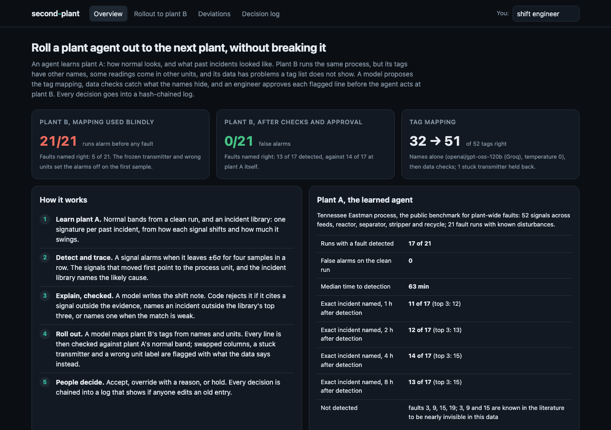
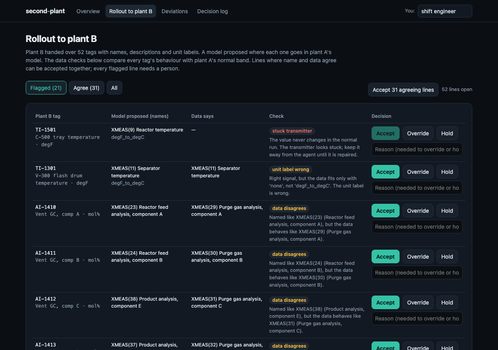
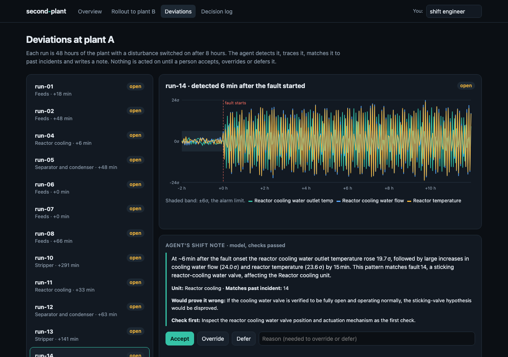

# second-plant

Roll an AI agent learned at one plant out to the next plant, without breaking it.

An agent learns plant A: how normal operation looks, and what past incidents looked like. Plant B runs the same process, but its tags have other names, some readings arrive in other units, and its data has problems that a tag list does not show. A model proposes how plant B's tags map onto plant A's model; data checks catch what the names hide; an engineer approves every flagged line before the agent acts at plant B. Every decision goes into a hash-chained log.

**Live demo (static, decisions stay in your browser):** [vishalbanwari.tech/second-plant](https://vishalbanwari.tech/second-plant/)



## Results

All numbers come from `python -m core.results` and are in [`data/results.json`](data/results.json).

| At plant B | Model's tag mapping used blindly | After data checks and approval |
|---|---|---|
| Fault runs that alarm before any fault happens | **21 of 21** | **0 of 21** |
| Faults named right | 5 of 21 | **13 of 17** detected |
| Tags mapped to the signal their data carries | 32 of 52 | 51 of 51 usable, 1 stuck transmitter held back |

For comparison, at plant A itself the agent names the right incident in 14 of 17 detected runs four hours after detection. With the checked mapping it keeps almost all of that at plant B; with the blind mapping it raises alarms from the first sample, because a stuck transmitter, a wrong unit label and mismapped analyzers all look like deviations.

**Plant A, the learned agent** (Tennessee Eastman process, 21 fault runs):

| | |
|---|---|
| Runs with the fault detected | 17 of 21 |
| False alarms on the clean run | 0 |
| Median time to detection | 63 min |
| Exact incident named, 1 / 2 / 4 / 8 h after detection | 11 / 12 / 14 / 13 of 17 (top 3: 12 / 13 / 15 / 15) |
| Not detected | faults 3, 9, 15, 19; 3, 9 and 15 are known to be nearly invisible in this data |

The detection threshold (±6σ for four samples) and the signature design were fixed before scoring. The cause accuracy is reported at four fixed times, not picked.

## How it works

1. **Learn plant A.** Normal bands from a clean run. An incident library with one signature per past incident: how far each of the 52 signals shifts, and how much more it swings than normal. Random-variation faults only show in the second part.
2. **Detect and trace.** A signal alarms when it stays outside ±6σ for four samples. The signals that moved first point to the process unit; the incident library names the likely cause by cosine similarity over an aligned window.
3. **Explain, checked.** A model (gpt-oss-120b on Groq) writes the shift note from the evidence. [`core/agent.py`](core/agent.py) rejects a note that cites a signal outside the evidence, names an incident outside the library's top three, names one when the best match is below 0.6, or has no "what would prove this wrong". A rejected note goes back once with the reasons, then falls back to a template. All 17 notes passed.
4. **Roll out to plant B.** The model maps plant B's 52 tags from names, descriptions and unit labels. [`core/checks.py`](core/checks.py) then assigns every tag to one plant A signal by how its data behaves against plant A's normal band, with the model's proposal as the tie-breaker, and explains each line: name and data agree, the data says another signal, the unit label is wrong, or the transmitter is stuck.
5. **People decide.** Accept, override with a reason, or hold. Overriding, holding and deferring need a reason. Every decision is appended to a log where each entry's hash covers the one before it; in PostgreSQL the table also refuses updates and deletes. The browser and the API compute the same hashes.





## Plant B, and the three problems a tag list does not show

[`core/plant_b.py`](core/plant_b.py) builds plant B from the same process data: tags renamed in another site's style (`TI-1201 R-100 bed temperature`), temperatures in °F, pressures in bar, flows in t/h, shuffled. Then three problems:

- **Swapped columns.** Reactor and flash drum pressure are swapped in the export. The names look fine.
- **Stuck transmitter.** The column tray temperature never changes.
- **Wrong unit label.** The flash drum temperature is labelled °F but still arrives in °C.

The model, reading names only, got 32 of 52 tags right. It mixed up the vent and reactor-feed analyzers, mapped two pressures to the same signal, and could not see any of the three problems. The data checks found all of them.

## Stack

Python (analysis, FastAPI), PostgreSQL (plant model, tags, mappings, incidents, append-only decision log), TypeScript and React (UI), Docker Compose. Plain Python for the analysis, no NumPy, so it is easy to read.

## Run it

```bash
docker compose up --build      # PostgreSQL, the API (seeds itself) and the UI
open http://localhost:5175
```

Without Docker: `python -m core.results` recomputes every number; `python -m pytest tests` runs the tests. Model outputs are cached in `data/`, so nothing needs an API key. To regenerate them, set `GROQ_API_KEY` and run `python -m core.mapper --refresh`.

The static demo: `python -m core.export && cd web && npm run build:static`.

## What this is not

- Plant B is the same simulated process with names, units and three data problems changed on purpose, so every answer is known. A real second plant also differs in equipment, operating points and control tuning; the signatures would need to be relearned or adapted there, and that is the harder half.
- The incident library has one example per incident.
- The data checks rely on plant B running near plant A's operating point. A plant at another throughput would need ranges relative to its own operating point.
- One process, no live connection to an MES or historian.

## Data

Tennessee Eastman process data from the Large Scale Systems Research Laboratory (Prof. Richard Braatz), University of Illinois. See [`data/NOTICE.md`](data/NOTICE.md).

MIT licence for the code.
